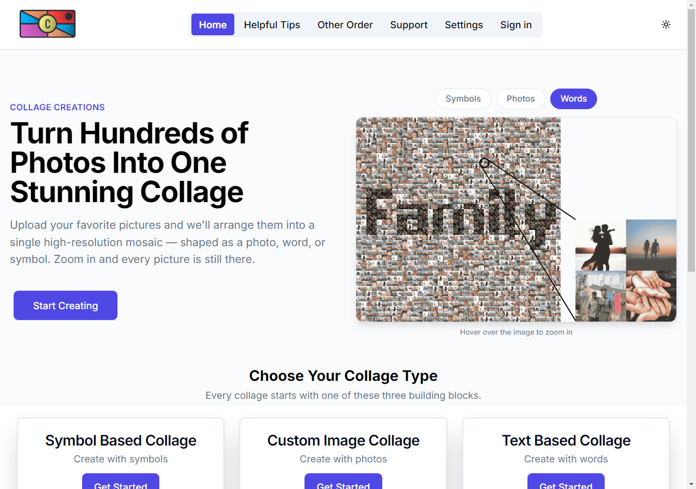

# Collage Creations

The storefront for [collagecreations.org](https://collagecreations.org): customers upload photos and order a printed **photo mosaic** – one large image (a photo, a word, or a symbol such as a heart) made out of many small photos. The API that builds the collages and takes payment is in [collageCreationsBackend](https://github.com/bsav0016/collageCreationsBackend).



## Why it exists

<!-- TODO: in your own words, why you built it (the business/gift idea, who it is for) -->

## The customer flow

1. **Pick a type** – a collage of a photo, of a word, or of a symbol (heart, paw, rings, flower), or an order of regular prints.
2. **Choose the main image, text or symbol**, the output size and the size of the small photos.
3. **Upload and crop the small photos** (touch-friendly crop screen with zoom).
4. **Create** – the backend builds the collage and the page shows real progress while it works.
5. **Preview** – a watermarked preview; signing in lets you save it and come back to it later.
6. **Check out** with Stripe (shipping and tax are calculated by the backend), then **download** or wait for delivery.

Other pages: sign-in (Google, Microsoft or an emailed code), my orders with reorder, saved collages, account settings with data export and deletion, tips, support tickets, and the legal pages. There is also a small **admin area** for orders and support tickets.

## Stack

- React 18, TypeScript, Vite 6, React Router 6
- Tailwind CSS, Radix UI primitives, lucide icons, light/dark theme (`next-themes`)
- `react-easy-crop` and `react-image-crop` for cropping, `react-image-file-resizer` for resizing
- Stripe Elements (`@stripe/react-stripe-js`), Sentry for error reporting
- GitHub Pages hosting, deployed by GitHub Actions

## Running it

```bash
npm install
npm run dev          # Vite dev server on http://localhost:4000
npm run build        # type-check, then build into build/
npm run preview
```

You need a running backend and a few environment variables in a `.env` file (git-ignored):

| Variable | Purpose |
| --- | --- |
| `VITE_BACKEND_URL` | Base URL of the API |
| `VITE_STRIPE_KEY` | Stripe publishable key |
| `VITE_SENTRY_DSN` | Sentry project DSN (optional) |
| `VITE_GOOGLE_CLIENT_ID`, `VITE_MICROSOFT_CLIENT_ID` | Customer sign-in |

## Deployment

Pushing to `main` runs `.github/workflows/deploy.yml`: install, type-check, build (with the three secrets `VITE_BACKEND_URL`, `VITE_STRIPE_KEY` and `VITE_SENTRY_DSN`), then publish `build/` to GitHub Pages under the custom domain `collagecreations.org`. `npm run deploy` does the same from a laptop with `gh-pages`.

## Design decisions

- **Server builds the collage; the browser only collects inputs.** Heavy image work and price, shipping and tax calculation all happen on the backend, so the page only displays what the API returns.
- **Progress bar driven by real task progress**, because building a large collage takes long enough that users would otherwise think the page had frozen.
- **Mobile-first layout.** Recent work reworked the crop screen and the size step so the main action stays visible on a phone.
- **Static hosting.** The app is a client-side SPA on GitHub Pages, so there is no server to run for the frontend; `public/404.html` supports client-side routes.
- **Type-checked in CI** before every deploy.

## Limitations

- No working automated tests; the old Create React App placeholder test was removed.
- Everything depends on the backend being up, since previews, pricing and checkout all call it.
- <!-- TODO: anything else you want to say (traffic, what you'd improve next) -->

## License

MIT. See [LICENSE](LICENSE).
