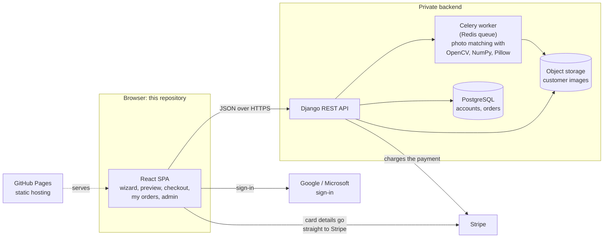
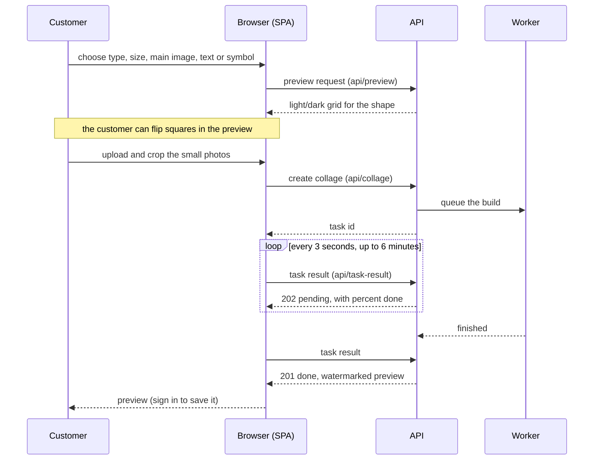
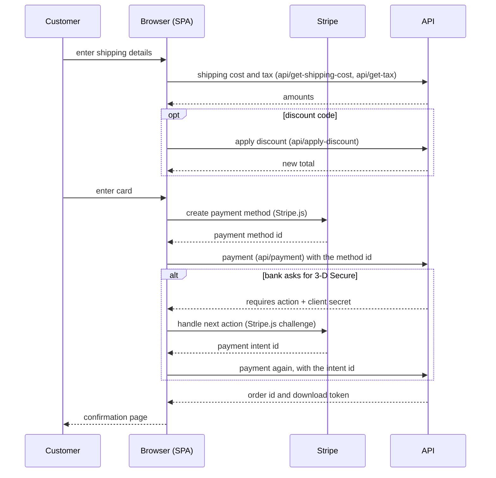

# Collage Creations architecture

This repository is the storefront: a React single-page app that collects a customer's choices and photos, shows progress and previews, and takes payment. The heavy work (matching photos, pricing, tax, shipping) happens in a separate API that lives in a private repository. This page shows how the two fit together and what the browser does at each step. The diagrams are Mermaid, which GitHub renders in place.

## System overview

The browser only collects inputs and displays what the API returns. Price, tax, shipping and the collage itself are all computed on the server, so the page cannot show a different amount from the one that is charged.

## Inside the app (`src`)

| Folder | Role |
| --- | --- |
| `pages/Customer` | The customer-facing pages: the collage wizard, preview, order and billing, download, my orders, saved collages, settings, tips, support, sign-in and the legal pages. |
| `pages/Admin` | A small admin area for orders and support tickets. |
| `services/` | One module per backend concern (`createCollage`, `createPreview`, `PaymentService`, `OrderService`, `customerAuthService` and so on). Pages go through these rather than calling the API themselves. |
| `lib/` | The network client and request constants shared by every service. |
| `context/` | Cross-page state: signed-in customer, the order in progress, server constants such as the print resolution, and toasts. |
| `dtos/` | Typed request and response shapes between the app and the API. |
| `components/` | Shared UI, including the touch-friendly crop screen and the card form. |

## Building a collage

The collage can take a while to build, so the browser starts the job and then follows its real progress instead of waiting on one long request.

Decisions worth noting:

- **Real progress, not a spinner.** The polling loop reports the percentage the worker has reached, so a long build does not look like a frozen page. It gives up with a clear message after about six minutes.
- **Preview first.** A watermarked preview is produced before anyone pays. The full-resolution file is only made for a paid order, and unpaid uploads are deleted by an hourly job.
- **Photos are prepared before upload.** Images are resized in the browser first to keep uploads small on a phone, and cropped photos are registered with the API (`api/resize-image`), which returns a temporary image id and a smaller copy for the page to show.

## Checkout

Card details never reach the API. Stripe.js turns them into a payment method id in the browser, and the API charges that.

Pricing comes from one server-side module, so the price shown, the amount charged and the tax cannot drift apart. The payment, discount and support endpoints are rate limited, and temporary images are reached through unguessable ids and download tokens.

## Accounts

Customers sign in with Google, Microsoft or a code emailed to them. Signing in is optional until the customer wants to save a collage, see past orders or reorder. After sign-in, a collage made while signed out can be claimed into the account (`api/claim-collage`), which attaches it to the customer so it is kept longer. Claiming a collage the customer already owns is safe to repeat. Account settings include a data export and account deletion.

## What lives elsewhere

The backend is a private repository, so this repository cannot run the full order flow on its own. Everything the browser needs from it is listed in `src/services`, and the API URL is a build-time setting (`VITE_BACKEND_URL`). Only public values are ever bundled into the page, so the Stripe publishable key and sign-in client ids are in the build and no secrets are.

## Build, test and deploy

Pushing to `main` runs GitHub Actions: install, type-check, test, build, then publish the static build to GitHub Pages under the custom domain. Unit tests (Vitest and Testing Library) cover the network layer, payment requests, pricing, sign-in state and the wizard step logic. Most page components and the crop screens are not covered by automated tests. See the [README](../README.md) for commands and the list of settings.
